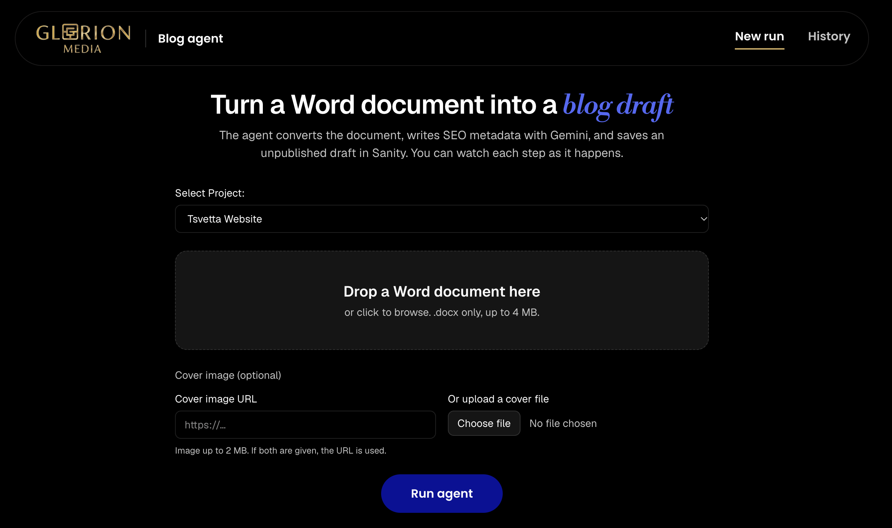
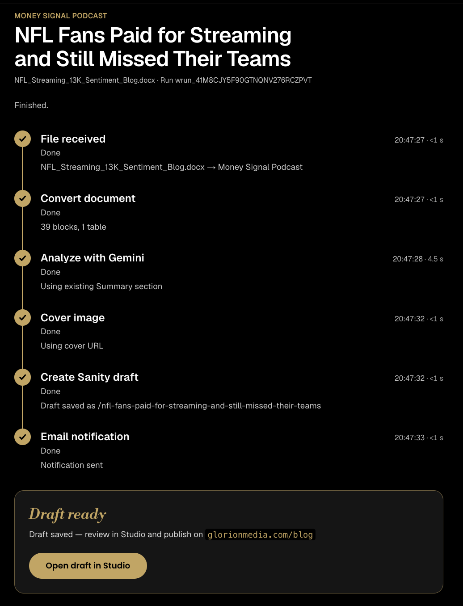
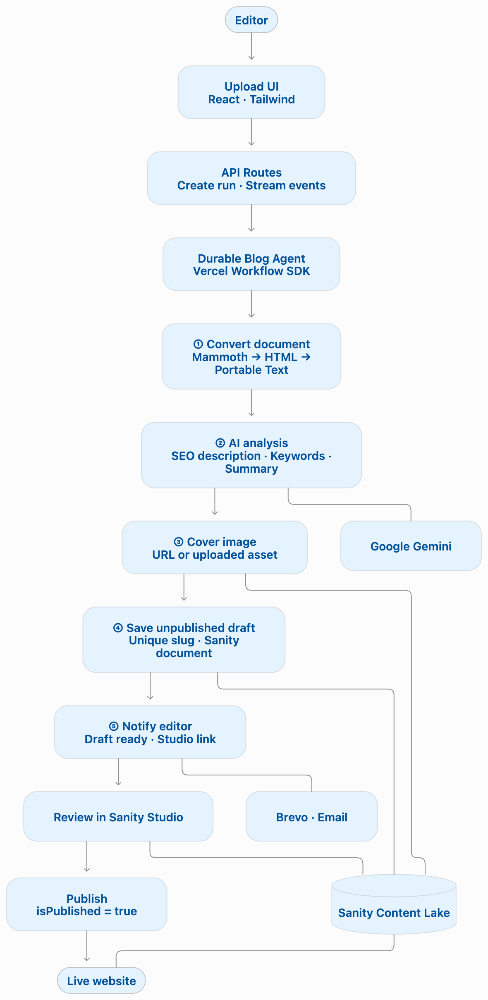
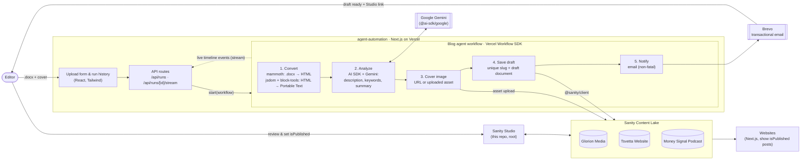

# Blog Studio





Blog Studio turns a Word document into a ready-to-review blog draft. An editor uploads a `.docx` (plus an optional cover image) in the **Blog agent** web app, picks the target site, and a durable AI workflow converts the document, writes the SEO description and summary with Google Gemini, and saves an unpublished draft to that site's Sanity project. Editors then review the draft in Sanity Studio and set `isPublished` to put it live on the website.

The repo holds two apps:

| Folder | What it is |
| --- | --- |
| `/` (root) | Sanity Studio (v6) with the `blog` schema and a table editor (`schemaTypes/`) |
| `agent-automation/` | Next.js app + Vercel Workflow SDK agent that creates the drafts (see its [README](./agent-automation/README.md)) |

## Architecture





### Integrations

- **Vercel Workflow SDK** (`workflow`): durable, retryable steps with a streamed timeline of events for the run page
- **mammoth**: converts `.docx` to HTML
- **jsdom + `@portabletext/block-tools`**: turn that HTML into Sanity Portable Text, including tables
- **Google Gemini via the Vercel AI SDK** (`ai`, `@ai-sdk/google`): writes the structured description, keywords and summary (default model `gemini-3.5-flash-lite`)
- **Sanity** (`@sanity/client`): creates draft documents and uploads cover assets, with one write token per project
- **Brevo**: emails editors when a draft is ready (skipped if not configured)
- **Vercel**: hosts the Next.js app and the workflow runs

## Development

```bash
# Sanity Studio (root)
npm install && npm run dev

# Blog agent
cd agent-automation && npm install && npm run dev
```
